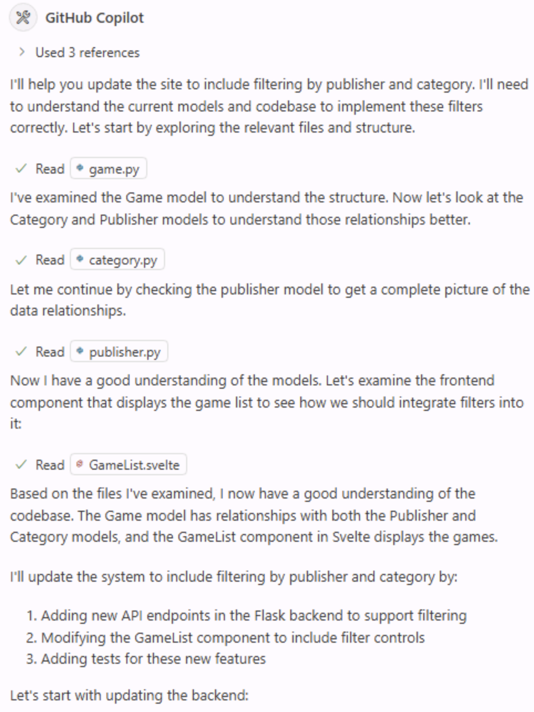

アプリケーションの簡単な更新でも、通常は複数のファイルを変更し、テストなどの処理を実行する必要があります。開発者は必要なファイルを探し、変更を行い、テストを実行して、デバッグし、見落としたファイルに気づいて再度変更する、といった作業を繰り返します。

このような作業に役立つのが Copilot Agent Mode です。

Copilot Agent Mode は、IDE 内でより自律的に作業します。開発者と同様に、既存のプロジェクト構造を調査し、必要な変更を行い、テストなどを実行して、見つかった問題を自動で修正します。Agent Mode を使ってサイトに機能を追加する方法を確認しましょう。

> [!NOTE]
> 名前は似ていますが、エージェントモードと cloud agent は異なる利用体験を提供します。エージェントモードは IDE 内で動作し、素早いフィードバックと対話を可能にします。Cloud agent はチームメンバーのように非同期で作業し、Issue やプルリクエストを通じてやり取りします。

この演習では、次の内容を学習します。

- Copilot Agent Mode がプロジェクトを調査し、関連ファイルを見つけ、複数ファイルにまたがる変更を行う方法。
- GitHub Copilot Agent Mode で UI とデータレイヤーに新機能を実装する方法。
- コードベースにマージする前に、Copilot Agent Mode が生成した変更とテストをレビューする方法。

## シナリオ

ゲームの一覧が増えてきたため、ユーザーがカテゴリーとパブリッシャーで絞り込めるようにします。前の演習で publishers helper を追加しました。次は Copilot Agent Mode を使い、残りのデータレイヤー、UI、テストを仕上げます。

## Tailspin Toys の Web サイトを実行する

変更を加える前に、Tailspin Toys の Web サイトを確認し、現在の機能を把握しましょう。

この Web サイトは、開発者をテーマにしたボードゲームのクラウドファンディングプラットフォームです。ゲーム一覧と詳細を表示できます。サイトは単一の Astro アプリで、ビルド時にページを静的 HTML として生成します。ページは frontmatter 内で Drizzle ORM を使ってローカルの SQLite データベースを直接検索します。別のバックエンド API やクライアントサイド UI フレームワークはありません。再利用可能なデータアクセスヘルパーは `src/lib/` にあり、インタラクティブな機能は標準 DOM API を使った小規模な Astro `<script>` で追加します。

### Web サイトを起動する

単一の Astro 開発サーバーを起動する `npm run dev` タスクが用意されています。GitHub Codespace で次の手順を実行します。

1. Codespace に戻ります。前の演習の後なので `main` にいるはずです。
2. Codespace 内で <kbd>Control</kbd>+<kbd>\`</kbd> (Mac) または <kbd>Ctrl</kbd>+<kbd>\`</kbd> (Windows/Linux) を押して、新しいターミナルを開きます。
3. フィルタリング作業用のブランチを作成して切り替えます。

   ```bash
   git checkout main
   git pull
   git checkout -b filtering-vscode
   ```

4. 次のコマンドを実行して Web サイトを起動します。

   ```bash
   npm run dev
   ```

   Astro の開発サーバーが起動すると、次のような URL を含むメッセージが表示されます。

   ```bash
   🚀 Tailspin Toys is ready!
      Astro server: http://localhost:4321
      Press Ctrl-C to stop.
   ```

> [!NOTE]
> `http://localhost:4321` のブラウザーウィンドウを開くよう求めるダイアログが表示された場合は、**x** を選択して閉じます。

5. <kbd>Command</kbd> (Mac) または <kbd>Ctrl</kbd> (Windows/Linux) を押しながら、ターミナルに表示された Astro サーバーのアドレス `http://localhost:4321` を選択して、Web サイトを開きます。

> [!NOTE]
> Codespace のターミナルで localhost の URL を選択すると、`https://<your-codespace-name>-4321.app.github.dev/` に自動的に転送されます。これは Codespace で Web サーバーを実行するためのプライベートトンネルです。

### Web サイトを確認する

Web サイトが起動したら、機能を確認します。主なページは次のとおりです。

- **ホームページ**: タイトル、画像、説明とともにボードゲームの一覧を表示します。
- **ゲーム詳細ページ**: ゲームを選択すると、タイトル、説明、パブリッシャー、カテゴリーなどの情報を表示します。

## Copilot でバックログを確認する

> [!TIP]
> **Copilot Chat を開く**
>
> 以下の演習を始める前に、Codespace に戻り、Copilot Chat パネルを開いて **New Chat** を選択し、新しい会話を始めます。モードとモデルの選択は演習によって異なるため、該当する手順で説明します。

Web サイトの初期実装は動作しますが、さらに機能を追加しましょう。まずバックログを確認します。テンプレートからプロジェクトを設定すると、Issue のバックログが自動的に作成されています。GitHub Copilot に一覧を表示してもらいます。

1. Chat ビューのエージェント選択欄から **Agent** を選択します。**Agent** は複数のファイルにまたがる変更を自律的に計画して実装し、ターミナルコマンドを実行してツールを呼び出します。

   

2. 利用可能なモデル一覧から **Claude Sonnet 4.5** を選びます。

> [!CAUTION]
> ワークショップの作成者が特定のモデルを推奨するものではありません。ワークショップの作成時に Claude Sonnet 4.5 を使用したため、手順に含めています。コード提案の一貫性を高め、学習しやすくするためです。ただし、LLM は確率的に動作するため、ワークショップに記載されたものと異なる提案が出る場合があります。これは通常の動作です。

> [!NOTE]
> LLM の確率的な性質により、Copilot が異なる MCP コマンドを使う場合がありますが、タスクは完了できるはずです。

3. 次のプロンプトを Copilot に送信して、Issue のバックログを確認します。

   ```plaintext
   Please show me the backlog of items from my GitHub repository. Help me prioritize them based on those which will be most useful to the user.
   ```

4. Issue 一覧を取得するために **Continue** を選択します。
5. 生成された Issue 一覧を確認します。

Copilot がユーザーに最も役立つと考える項目を優先順位付けしたことも確認できます。

## 指示ファイルを確認する

エージェントにコードを生成させる前に、作業のコンテキストを Copilot に渡す指示ファイルを確認しましょう。Web サイトに機能を追加する方法が記載された [UI 指示ファイル](https://github.com/github-samples/tailspin-toys/blob/main/.github/instructions/ui.instructions.md)を使います。

1. Codespace で `.github/instructions/ui.instructions.md` を開きます。
2. 機能追加に関する全体的なガイダンスを確認します。次の内容が含まれます。
   - アーキテクチャの概要。
   - コンポーネントの設計、テスト容易性、アクセシビリティの原則。
   - ファイル種別ごとの指示ファイルへのリンク。Astro、Tailwind CSS、Drizzle などがあります。

> [!TIP]
> 指示ファイルから、ほかの指示ファイルやプロジェクト内のファイルを参照できます。パスは指示ファイルの場所からの相対パスです。これにより、指示を再利用したり、複雑な内容を小さく管理しやすい単位に分けたり、例やテンプレートを示したりできます。

## フィルタリング機能を実装する

フィルタリングを完成させるには、少なくとも次の 3 つの更新が必要です。

- データレイヤー (`src/lib/`) の残りのフィルタリングロジックを追加または調整する。
- フィルタリングの動作に関するテストを追加または更新する。
- ゲーム一覧ページにフィルタリング UI を追加する。

また、すべてのテストに合格してからコードベースにマージする必要があります。Copilot Agent Mode にこれらの作業を任せましょう。

1. Copilot との現在の会話を続けるか、**New Chat** を選択して新しい会話を始めます。
2. **Add Context**、**Instructions**、**ui** の順に選択して指示ファイルを追加します。

   

3. Chat ビューのエージェント選択欄で **Agent** が選択されていることを確認します。

   

4. モデルが **Claude Sonnet 4.5** のままであることを確認します。
5. バックログの関連 Issue に基づいて機能を実装するよう、次のプロンプトで Copilot に依頼します。

   ```plaintext
   Please update the site to include filtering by publisher and category based on the requirements from the related GitHub issue in the backlog. A publishers helper already exists from the previous exercise, so preserve and refine that work as needed while completing the remaining data-layer, UI, and tests. Ensure all tests are passing before completion. The server is already running, so you do not need to start it up.
   ```

6. Copilot がプロジェクトを調査し、機能に関連するファイルを探す様子を確認します。データレイヤーのヘルパー、UI、テストを見つけてファイルを変更し、テストを実行します。

   

> [!NOTE]
> Copilot はプロジェクトの調査、ファイルの変更、テストの実行などを行うため、複雑さやコードベースの規模によっては数分かかります。処理中に、コードエディターに **Keep** と **Undo** が表示される場合があります。作業が完了すると、変更ごとに **Keep** または **Undo** を選択できます。作業中に選択する必要はありません。

7. Copilot の指示に従い、**Continue** を選択してテストを実行します。

   

8. 処理中に一時停止したり、テストが失敗したりする場合があります。Copilot は、タスクが完了しエラーが見つからなくなるまで、コード生成とテストを繰り返します。

   

9. 生成されたコードに問題がないか確認します。

> [!CAUTION]
> Copilot などの AI ツールが生成したコードは、必ずレビューしてください。

10. Web サイトを起動しているブラウザーに戻り、新しい機能を試します。
11. すべて動作し、コードのレビューも終わったら、Copilot Chat ウィンドウで **Keep** を選択します。

## まとめと次のステップ

この演習では、GitHub Copilot Agent Mode を使って Tailspin Toys の Web サイトに機能を追加する方法を確認しました。次の内容を学習しました。

- GitHub Copilot Agent Mode で UI とデータレイヤーに新機能を実装する方法。
- Copilot Agent Mode がプロジェクトを調査し、関連ファイルを見つけ、複数ファイルにまたがる変更を行う方法。
- コードベースにマージする前に、Copilot Agent Mode が生成した変更とテストをレビューする方法。

次は、[Playwright MCP サーバーで機能をテストし][next-lesson]、プルリクエストを作成します。

### おまけの演習 — ページネーションを実装する

ゲーム一覧が増えるとページネーションが必要になります。この演習で学んだ方法を使い、Copilot にページネーションの実装を依頼します。次の点を検討してください。

- 既存の指示ファイルを使うなど、ベストプラクティスに従う。
- ページサイズをユーザーが選べるようにするか、固定値にするかを決める。
- 希望どおりの実装になるよう、必要なガイダンスをプロンプトに含める。
- Copilot にコンテキストを与えて変更を依頼し、反復が必要な場合があります。これは Copilot を使う通常の進め方です。

## リソース

- [Copilot の Ask、Edit、Agent モード: 機能と使い分け][choose-mode]
- [VS Code のエージェントモード][vs-code-agent-mode]

[previous-lesson]: ../1-custom-instructions/
[next-lesson]: ../3-mcp/
[choose-mode]: https://github.blog/ai-and-ml/github-copilot/copilot-ask-edit-and-agent-modes-what-they-do-and-when-to-use-them/
[vs-code-agent-mode]: https://code.visualstudio.com/docs/copilot/chat/chat-agent-mode
