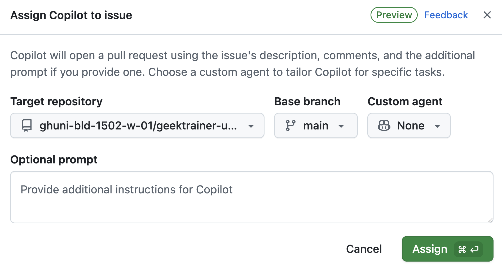

| [← Lição anterior: Instruções personalizadas][previous-lesson] |
|:--|

É provável que poucas organizações não enfrentem problemas de dívida técnica. Isso pode incluir problemas de segurança não resolvidos, código legado que precisa de atualizações ou solicitações de funcionalidades que ficaram no backlog por falta de tempo. O agente de nuvem do GitHub Copilot foi criado para tarefas como atualizar código e adicionar funcionalidades de forma autônoma. Quando termina o trabalho, ele cria um rascunho de pull request para que uma pessoa desenvolvedora o revise. Assim, é possível delegar tarefas repetitivas, acelerar o desenvolvimento e se concentrar em questões mais amplas.

Neste exercício, você explorará com o agente de nuvem do Copilot:

- a personalização do ambiente de geração de código.
- como garantir que as operações sejam executadas com segurança.
- a importância de delimitar claramente as issues.
- como atribuir issues ao Copilot.

## Cenários

A Tailspin Toys tem uma dívida técnica que gostaria de resolver. As pessoas contratadas inicialmente para criar a primeira versão do site deixaram a documentação em um estado inadequado — na verdade, ela está totalmente ausente. Como primeiro passo, a equipe quer adicionar comentários TSDoc a todas as funções exportadas do aplicativo.

Além disso, a equipe de design está pronta para melhorar a descoberta de jogos. Ela quer que a página de detalhes de cada jogo mostre jogos relacionados — outros títulos da mesma categoria — para que as pessoas continuem navegando. Ainda não é necessária uma implementação refinada; basta algo que possa ser usado em testes de aceitação da experiência. Isso é um bloqueio no momento, mas há outras issues com prioridade maior.

Esses são exemplos de tarefas que podem perder prioridade rapidamente e que são ideais para delegar ao agente de nuvem do Copilot. Ele trabalha de forma assíncrona, permitindo que a pessoa desenvolvedora se concentre em outras tarefas e volte depois para revisar o trabalho.

## Conheça o agente de nuvem do GitHub Copilot

O [agente de nuvem do GitHub Copilot](https://docs.github.com/copilot/concepts/agents/cloud-agent/about-cloud-agent#overview-of-copilot-cloud-agent-formerly-copilot-coding-agent) executa tarefas em segundo plano de maneira semelhante a uma pessoa desenvolvedora. Há várias formas de trabalhar com ele, incluindo [atribuir uma issue do GitHub ao Copilot](https://docs.github.com/copilot/how-tos/use-copilot-agents/cloud-agent/start-copilot-sessions). Depois da atribuição, o Copilot cria um rascunho de pull request para acompanhar o progresso, configura um ambiente e começa a trabalhar. Você pode examinar a sessão enquanto ela está em andamento ou depois de concluída. Quando a solução estiver pronta para revisão, o agente marcará você no pull request.

## A importância de instruções bem delimitadas

Não há mágica no GitHub Copilot: não é possível pular a etapa de pensar. Até tarefas aparentemente simples podem se tornar complexas quando examinadas de perto. Por isso, [defina com atenção o escopo das tarefas para o agente de nuvem do Copilot][cloud-agent-best-practices]. Trate-o como um parceiro de programação com IA: trabalhe por etapas, aprenda, experimente e adapte o processo. Os fundamentos do desenvolvimento de software não mudam com a inclusão de IA generativa.

## Instruções personalizadas neste repositório

Nos exercícios anteriores, você conheceu as instruções personalizadas e como elas orientam o Copilot. Se já concluiu o exercício prático sobre instruções personalizadas, viu `.github/copilot-instructions.md` em ação; caso contrário, este é um bom momento para examiná-lo rapidamente. Antes de atribuir trabalho ao agente de nuvem, leia os arquivos de instruções incluídos no repositório sem alterá-los. Assim, você poderá observar seus efeitos mais tarde.

Abra os arquivos a seguir na interface Web do GitHub ou em um codespace, se já tiver um aberto:

- `.github/copilot-instructions.md`: examine a seção **Code standards**, principalmente as expectativas sobre convenções de TypeScript e comentários TSDoc.
- `.github/instructions/unit-tests.instructions.md`: observe o frontmatter `applyTo`, que associa as instruções aos arquivos `**/*.test.ts`.

Ao atribuir a issue `Code lacks documentation` ao agente de nuvem na próxima seção, observe no pull request os comentários TSDoc, as convenções TypeScript e os cabeçalhos de comentários. Essas orientações vêm dos arquivos de instruções. Voltaremos a esse ponto ao revisar os PRs em um exercício posterior.

## Configure o ambiente de desenvolvimento do agente de nuvem

Criar código normalmente exige um ambiente específico e scripts de configuração para garantir que tudo esteja pronto. O mesmo vale ao atribuir tarefas ao Copilot, que trabalha de maneira semelhante a um engenheiro de software.

O agente de nuvem usa o [GitHub Actions][github-actions] como ambiente de execução. Você pode personalizá-lo com um [workflow de configuração especial][setup-workflow], definido em `.github/workflows/copilot-setup-steps.yml`, que é executado antes do início do trabalho. Assim, o agente terá as ferramentas e dependências necessárias. Esse arquivo já está configurado no laboratório para facilitar o fluxo e demonstrar o recurso. Ele disponibiliza Node.js, dependências do projeto, binários de navegador para testes de ponta a ponta e o banco SQLite migrado e preenchido para o aplicativo Astro:

```yaml
name: "Copilot Setup Steps"

# Permite testar as etapas de configuração na guia "Actions" do repositório
on: workflow_dispatch

env:
  ASTRO_TELEMETRY_DISABLED: "1"

jobs:
  copilot-setup-steps:
    runs-on: ubuntu-latest
    # Defina as permissões no nível mínimo necessário para *suas etapas*. O Copilot receberá seu próprio token para as operações dele.
    permissions:
      # Para clonar o repositório durante as etapas de configuração, por exemplo, para instalar dependências, você precisará da permissão `contents: read`. Se não clonar o repositório nas etapas de configuração, o Copilot fará isso automaticamente depois que elas forem concluídas.
      contents: read
    steps:
      - name: Checkout code
        uses: actions/checkout@v5

      # Configuração do frontend/aplicativo: Node.js (todo o aplicativo agora usa Astro + Drizzle/libSQL)
      - name: Set up Node.js
        uses: actions/setup-node@v6
        with:
          node-version: "lts/*"
          cache: "npm"
          cache-dependency-path: "./package-lock.json"

      - name: Install JavaScript dependencies
        run: npm ci

      - name: Install Playwright browsers
        run: npx playwright install --with-deps chromium

      # Migra e preenche o banco de dados SQLite local para que compilações e testes tenham dados.
      - name: Set up the database
        run: npm run db:setup
```

O arquivo é semelhante a outros workflows do GitHub, mas tem alguns pontos importantes:

- Ele contém um único job chamado `copilot-setup-steps`. Esse job é executado no GitHub Actions antes de o Copilot começar a trabalhar no pull request.
- O gatilho `workflow_dispatch` permite executar o workflow manualmente na guia **Actions** do repositório. Isso é útil para testar se o workflow funciona, sem esperar o Copilot iniciá-lo.

## Adicione a documentação

Embora todo mundo reconheça a importância da documentação, muitos projetos têm informações desatualizadas ou não têm documentação. Esse tipo de dívida técnica costuma não ser resolvido, reduzindo a produtividade e dificultando a manutenção do código e a integração de novas pessoas à equipe. O Copilot é muito útil para criar documentação, por isso esta é uma issue ideal para atribuir ao agente de nuvem. Ele trabalhará em segundo plano para produzir a documentação necessária. Em um exercício futuro, você voltará para revisar o resultado.

1. Em uma nova guia do navegador, acesse o repositório no github.com.
2. Selecione a guia **Issues**.
3. Selecione **New issue** para abrir a caixa de criação de issue.
4. Selecione **Blank issue**.
5. Defina **Title** como `Code lacks documentation`.
6. Defina **Description** como:

   ```plaintext
   Our organization has a requirement that functions and methods include TSDoc doc comments where helpful. Unfortunately, recent updates haven't followed this standard. We need to update the existing code to ensure doc comments are included where they clarify behavior.
   ```

7. Selecione **Create** para criar a issue.
8. No lado direito, selecione **Assign to Copilot** para abrir a caixa de atribuição.

   

9. Selecione **Assign**.

   

10. Selecione a guia **Pull Requests**.
11. Abra o pull request (PR) recém-gerado, cujo título será semelhante a `[WIP]: Code lacks documentation`. Se o PR ainda não aparecer, aguarde um ou dois minutos e atualize a página.
12. Depois de alguns minutos, o Copilot deverá criar uma lista de tarefas.

> [!NOTE]
> A lista de tarefas pode levar alguns minutos para aparecer no PR. O Copilot está configurando o ambiente (executando o workflow descrito anteriormente), analisando o projeto e definindo a melhor abordagem.

13. Revise a lista e as tarefas que serão executadas.
14. Role a linha do tempo do pull request e procure uma atualização indicando que o Copilot começou a trabalhar na issue.
15. Selecione o botão **View session**.

   

> [!CAUTION]
> Talvez seja necessário atualizar a página para ver o indicador atualizado.

16. Observe a sessão em tempo real e como o Copilot resolve o problema: explora o código, entende o estado, pausa para pensar e escolher um plano e, então, cria o código.

Isso provavelmente levará alguns minutos. Uma das principais vantagens do agente de nuvem é executar tarefas de forma assíncrona, permitindo que você se concentre em outras atividades. Vamos aproveitar esse recurso: enquanto o agente trabalha, atribua outra tarefa a ele e depois volte sua atenção para a criação de funcionalidades no aplicativo.

## Adicione uma seção de jogos relacionados à página de detalhes

Uma das grandes vantagens do agente de nuvem do GitHub Copilot é a possibilidade de dividir o trabalho: você pode se concentrar em algumas tarefas enquanto o agente trabalha em outras. Mesmo que adicionar uma seção de jogos relacionados não leve muito tempo, esse tempo pode ser usado para outras tarefas. Vamos atribuí-la ao agente de nuvem.

1. Volte ao repositório no github.com.
2. Selecione a guia **Issues**.
3. Selecione **New issue**.
4. Selecione **Blank issue**.
5. Defina **Title** como `Show related games on the game details page`.
6. Defina **Description** como:

   ```markdown
   We want to help people discover more games by showing related games on each game's details page. The design team wants to explore the UX and do some acceptance testing. Our requirements are:

   - Add a data-access helper in `src/lib/` that returns other games in the same category as a given game, excluding that game
   - Show a "Related games" section on the game details page that uses the helper
   - Handle the case where a game has no related games
   - There should be unit tests created for the new helper
   - Before creating the PR, ensure all tests pass
   ```

7. Selecione **Create** para criar a issue.
8. No lado direito, selecione **Assign to Copilot** para abrir a caixa de atribuição.

   

9. Selecione **Assign**.

Pouco depois, você deverá ver um conjunto de 👀 no primeiro comentário da issue, indicando que o Copilot começou a trabalhar.


O Copilot está trabalhando na segunda solicitação. O agente de nuvem funciona de maneira semelhante a uma pessoa engenheira de software, então você não precisa acompanhá-lo ativamente; revise o trabalho quando ele terminar. Agora, vamos criar e usar agentes personalizados.

## Resumo e próximos passos

Este exercício apresentou o [agente de nuvem do GitHub Copilot][copilot-agents]. Com ele, você pode atribuir issues ao Copilot para execução assíncrona. Use-o para resolver dívida técnica, criar funcionalidades ou ajudar a migrar código entre frameworks.

Você explorou estes conceitos:

- personalizar o ambiente de geração de código.
- garantir que as operações sejam executadas com segurança.
- delimitar issues com clareza.
- atribuir issues ao Copilot.

Enquanto o agente de nuvem trabalha em segundo plano, vamos criar e usar agentes personalizados. O [agente de nuvem do Copilot também pode usar servidores MCP][cloud-agent-mcp] e receber instruções personalizadas, que já exploramos nos módulos anteriores.

## Recursos

- [Sobre o agente de nuvem do Copilot][copilot-agents]
- [Atribuir issues do GitHub ao Copilot][assign-issue]
- [Práticas recomendadas para o workflow de configuração do agente de nuvem][cloud-agent-best-practices]

| [Próxima lição: Agentes personalizados →][next-lesson] |
|--:|

[previous-lesson]: ../1-custom-instructions/
[next-lesson]: ../3-custom-agents/
[cloud-agent-mcp]: https://docs.github.com/copilot/how-tos/copilot-on-github/customize-copilot/customize-cloud-agent/extend-cloud-agent-with-mcp
[assign-issue]: https://docs.github.com/copilot/how-tos/use-copilot-agents/cloud-agent/start-copilot-sessions
[setup-workflow]: https://docs.github.com/copilot/how-tos/copilot-on-github/customize-copilot/customize-cloud-agent/customize-the-agent-environment
[copilot-agents]: https://docs.github.com/copilot/concepts/agents/cloud-agent/about-cloud-agent
[cloud-agent-best-practices]: https://docs.github.com/copilot/how-tos/copilot-on-github/customize-copilot/customize-cloud-agent/customize-the-agent-environment
[github-actions]: https://docs.github.com/actions
